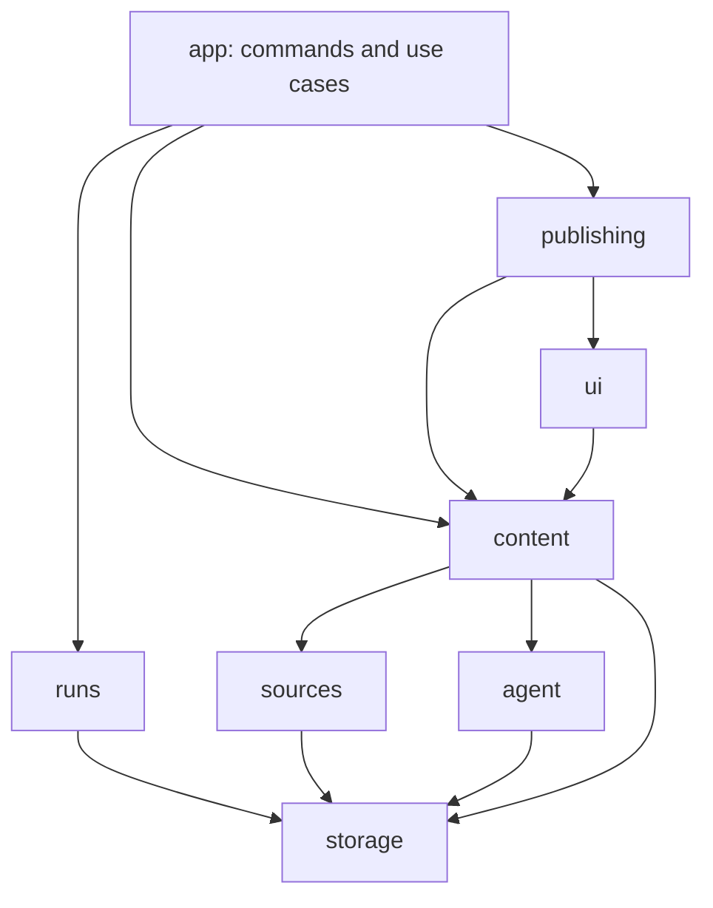

# Architecture

Feedgarden has an installable CLI core and an optional Jekyll UI. The two TypeScript files at the root of `src/` are executable bootstraps. Application code is grouped by responsibility:

| Module | Owns |
| --- | --- |
| `app/` | Command parsing and validation, output envelopes, setup/upgrade, processing use cases and checkpoint composition |
| `instance/` | XDG/native Windows/workspace resolution, configuration loading and explicit runtime context |
| `runs/` | Frozen scopes, source generations, leases, cancellation, durable runtimes and scheduler artifacts |
| `sources/` | Channel discovery, query-only reads, collectors, parsers and raw source enrichment |
| `content/` | Explicit admission, selection, summaries/transcripts, archives, relations and projections |
| `agent/` | Model clients, backend processes, paid attempts, quota/cooldown handling and owned workspaces |
| `publishing/` | Target inspection, export, adoption, pure diffing, Git commit/push confirmation and topic reconciliation |
| `ui/` | Trusted Jekyll builds, static serving and Clippings media handling |
| `storage/` | SQLite schema, typed repositories, atomic writes, snapshots, backups, search and transport coordination |
| `platform/` | Files, hashes, clocks, concurrency, process execution, Git and validated HTTP transport |
| `contracts/` | Configuration schemas, data types, artifact validation, error types and shared policy values |

Cross-module consumers use named exports from `index.ts`. The small leaf APIs in `contracts/` and `platform/` have explicit entries in [the dependency policy](../src/modules.json). Internal files import their siblings directly. There are no forwarding files at the old flat paths and no wildcard public exports. `npm run check:architecture` checks static, dynamic and type imports, public entrypoints, dependency directions, raw database access, runtime cycles and literal runtime resource paths. It also checks the worker's small startup dependency graph. The build runs this gate before compiling.

## Instance context

Configuration schemas are pure contracts. `instance/paths.ts` computes directories without writing files. Loading constructs an `InstanceContext` containing the parsed configuration fields, resolved `paths` and an explicit `executionPolicy`. Paths and fallback policy do not depend on object identity or WeakMaps. The context, paths and policy are frozen; command-specific configurations are created as value copies.

`configuration(context)` returns only persisted settings. Run configuration hashes use this representation, so changing a runtime directory or enabling a fallback policy does not accidentally invalidate an existing content recipe. Programmatic callers construct contexts with explicit `InstancePaths`. CLI defaults continue to follow XDG and Windows native directories.

## Persistence and recovery

Application writers receive `Storage`; status, search and doctor receive `ReadStorage`. Neither interface exposes SQLite connections or prepared statements. Repository methods have typed arguments and rows. The concrete session, statement cache and SQL clauses remain inside `storage/`. Tests that seed legacy databases or inject storage faults use the explicit fixture adapter in `tests/support/`.

Storage operations commit summary acceptance, batch attempts, source admissions, selection changes, ranking evidence, archive import/maintenance, target adoption and run claims atomically. Archive scans retain immutable bytes in a disk-backed snapshot. Filesystem journals still protect swaps across database and content-tree updates. Lease checks and conflict rechecks occur at the commit boundary. Prepared statements are cached lazily, including on read-only sessions, so large candidate sets do not incur per-row preparation and legacy stores can still be inspected before explicit upgrade.

The SQLite schema, persisted run scope, cache recipes, output routes and bilingual Markdown format are unchanged by modularization. A golden fixture captured from the pre-refactor sources verifies summary/task/selection hashes, reserved paths and rendered bytes. No data migration is introduced for this directory change.

## Acquisition, processing and publication

Source adapters receive only channel state, discovery state and HTTP capabilities. Real-time queries use an in-memory content store with shared transport pacing. `content/admissions.ts` owns explicit saving; `content/collect.ts` composes collection with archive and selection policy. Parsing podcast data is separate from paid transcript processing. Pure Markdown rendering depends on content contracts rather than processing code.

Model transport and attempt accounting are separate modules. Typed model errors and task contracts are shared without a client/attempt dependency cycle. Content recipes remain independent of routing. Interrupted artifacts and accepted caches retain their existing recovery and retry behavior.

Publication operates in an owned checkout. Inspection, export, adoption, diffing, push confirmation and topic merging have separate implementations. Owner manifests, generations, identity reservations, hashes and deletion intents still determine the diff. Uncertain pushes retain their durable receipts; confirmation checks fetched history before retrying. UI builds use bundled trusted dependencies in isolated staging.

The root worker acknowledges its launch through `storage/worker.ts` before importing the CLI. Its handshake closure contains only that module and the SQLite adapter. Moving sources does not change copied durable runtimes, packaged skills, model tool resources or configuration locations. Package smoke tests exercise installation, npm execution, detached startup and skill registration.
