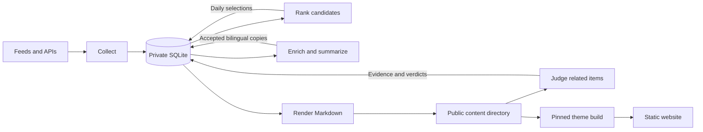

# Architecture

Feedgarden is a local TypeScript pipeline that collects source material, stores private evidence in SQLite, and produces bilingual Markdown for a separate static-site build. The runner owns collection, selection and accepted content. The pinned Jekyll Obsidian theme owns the generated website and its browser interactions.

## Data flow

SQLite retains candidates, evidence and accepted copies that may be absent from the public directory. After the first archive import, rendering uses that private snapshot and the current selection. Changing the output directory does not replace the private snapshot with the files found there.

## Command orchestration

[src/cli.ts](../src/cli.ts) loads configuration, acquires the runner lock and database lease, recovers an interrupted content replacement, and records the run. A scheduled `run --due` performs these steps:

1. Collect due streams through their ordered channel fallbacks.
2. Refresh ranking evidence and daily selection for enabled sources with a selection policy, even when their collection was not due.
3. Recover saved summary artifacts, prepare eligible items, and process the summary queue. Podcast transcript tasks run as part of this preparation and queue processing.
4. Render accepted public content to Markdown.
5. Judge related-item candidates from that public content, then render again to include the resulting recommendation manifest.
6. Create online database backups.
7. Publish when automatic publication is enabled and `--no-publish` is absent.

Individual commands expose the same stages. `rank`, `summarize`, `archives`, and `topics apply` render their local results. `relate` renders before and after judging. Explicit `render` forces a rebuild of the Markdown tree. None of these rendering operations builds HTML or calls the model; summary and relation tasks make their own model calls.

The separate `site:build` command builds HTML from the existing content tree. `site:serve` only serves an existing build. Publication also validates its candidate content with the pinned theme build before committing and pushing changes.

## Module responsibilities

| Area | Implementation | Responsibility |
| --- | --- | --- |
| Configuration | [config.ts](../src/config.ts) | Validate configuration, source IDs, channels and budgets. |
| Persistence | [store.ts](../src/store.ts) | Open and initialize SQLite, cache prepared statements, persist evidence, account for calls, and manage leases. Other modules also issue domain-specific SQL through the store. |
| Collection | [collect.ts](../src/collect.ts), [channels/](../src/channels/) | Schedule streams, try fallbacks, normalize source entries, and retain coverage and cursor state. |
| HTTP transport | [http.ts](../src/http.ts), [public-url.ts](../src/public-url.ts), [public-http.ts](../src/public-http.ts) | Cache responses, pace hosts, respect robots rules for page fetches, and pin public article destinations. |
| Selection | [rank.ts](../src/rank.ts), [selection.ts](../src/selection.ts), [scoring.ts](../src/scoring.ts) | Refresh source-specific ranking evidence and materialize daily selections, including frozen historical dates. |
| Source enrichment | [source-content.ts](../src/source-content.ts), [hackernews.ts](../src/hackernews.ts), [producthunt.ts](../src/producthunt.ts) | Prepare article, discussion, media and repository evidence before summary generation. |
| Summary workflow | [items.ts](../src/items.ts) | Plan work, enforce eligibility, recover batches, reuse cached copies, accept bilingual results, and reserve stable item paths. |
| Agent execution | [agent.ts](../src/agent.ts), [agent-backends.ts](../src/agent-backends.ts) | Resolve configuration and run OpenCode (default) or DSH over ACP, with explicit child environment inheritance. |
| Fixed agent tools | [artifact-tools.mjs](../src/artifact-tools.mjs), [mcp-server.mjs](../src/mcp-server.mjs), [opencode-ready.mjs](../src/opencode-ready.mjs) | Share fixed input/output validation and atomic writes, expose local stdio MCP, and wait for direct tool registration. DSH uses its restricted plugin. |
| Agent processes | [agent-process.ts](../src/agent-process.ts), [process-command.ts](../src/process-command.ts) | Resolve executable entrypoints without shell concatenation and terminate owned ACP/MCP process trees with bounded cleanup. |
| Contracts and topics | [topics-contract.mjs](../src/topics-contract.mjs), [task-contract.mjs](../src/task-contract.mjs), [topics.ts](../src/topics.ts) | Validate outputs and maintain the canonical bilingual vocabulary. |
| Auxiliary tasks | [fixed-tasks.ts](../src/fixed-tasks.ts), [podcasts.ts](../src/podcasts.ts), [relations.ts](../src/relations.ts) | Persist transcript reductions and relation judgments, recover artifacts, and share the call budget. |
| Archives and Markdown | [archives.ts](../src/archives.ts), [site.ts](../src/site.ts), [collections.ts](../src/collections.ts) | Import and maintain private archive bytes, preserve opaque files, render locale content, share built-in collection definitions, and recover directory replacements. |
| Delivery | [backup.ts](../src/backup.ts), [build-site.ts](../src/build-site.ts), [publish.ts](../src/publish.ts) | Back up SQLite, validate the locked theme, and publish managed content from an isolated Git worktree. |

## Durable state

The [schema](../src/store.ts) separates source evidence, scheduling, accepted results and public-path reservations:

| State | Main tables | Purpose |
| --- | --- | --- |
| Source evidence | `raw_responses`, `items`, `item_versions`, `observations`, `http_cache` | Retain source responses, current normalized items, fact revisions, observations and reusable HTTP representations. |
| Collection progress | `channel_state`, `gaps` | Track stream cursors, attempt times, coverage and failures. |
| Ranking | `feed_rankings`, `feed_rank_snapshots`, `feed_selection`, `feed_selection_days` | Keep ranking observations and materialized selection decisions separate from source identity. |
| Summary work | `feed_planning`, `feed_jobs`, `feed_batches`, `feed_cache`, `feed_summaries` | Track preparation, attempts, fixed batch inputs, reusable copy and accepted bilingual snapshots. |
| Archive state | `feed_archives`, `feed_archive_files`, `feed_excluded`, `feed_item_paths` | Preserve historical bodies and opaque bytes, explicit exclusions and stable source/day numbers. |
| Auxiliary work | `podcast_transcripts`, `feed_tasks`, `feed_relation_pairs` | Retain full transcripts, intermediate tasks and evidence-backed relation verdicts. |
| Coordination and audit | `feed_meta`, `job_lease`, `agent_calls`, `runs` | Record revisions and policy markers, ownership, quota usage and run outcomes. |

The item identity is `(source, native ID)`. Public paths use a separate source/day number, so arbitrary native IDs never become path components. Topic IDs come from [config/topics.json](../config/topics.json); the registry is shared by both published languages.

Database triggers enqueue planning when relevant item facts change and update the content revision when accepted copies or exclusions change. Separate triggers advance the recommendation revision when published relation fields change. Observation timestamps alone do not require a new summary. Maintenance and selection writers also enqueue affected identities where necessary. Rendering uses these persisted revisions and configuration fingerprints to detect unchanged output.

## Task execution and acceptance

Summary planning applies the cutoff, source-specific filters, selection and refresh policy before model work. The queue is FIFO within each source and round-robin across sources. Summary cache identity includes normalized fixed input, source identity, backend, agent version, resolved model/effort, provider configuration fingerprint, skill content and contract revisions. Podcast transcript recipes also participate in the key.

The agent receives a trusted task skill and fixed source material. The restricted plugin exposes only `feedgarden_input` and `feedgarden_result`; source material is treated as untrusted data. The client validates the returned artifact again before acceptance. Summary acceptance checks identities, bilingual copy, topic references and media selections. A failed revision retains the preceding accepted snapshot.

Trusted skills are resolved from the installed package rather than the caller's working directory and cached for the process. A working-directory copy cannot replace those instructions. Transcript processing has an explicit segment budget; exceeding it retains the full evidence and stops before paid work. See [Podcasts](podcasts.md) for recovery and budget controls.

Transcripts and relations use the auxiliary task contract. Complete transcripts are reduced through saved intermediate tasks before the final episode summary. Relation tasks require evidence from both public articles; the published manifest contains only target paths and expiry times. Summary, transcript and relation attempts share the database-backed daily call budget, including failed and repair attempts. Rendering and HTML building do not spend that budget.

Saved artifacts are recovered before another paid attempt. Topic-registry updates are persisted before the summary transaction; the file and database remain separate durable commits. An interruption can leave an unused topic, and recovery verifies the registry against the fixed input before accepting the saved result.

## Concurrency and recovery

The CLI combines a filesystem lock with a renewable database lease. The lease is acquired with a conditional SQLite write, renewed during work, and checked again at acceptance, content replacement and publication boundaries. Losing either lock cancels active work. An expired owner cannot renew its previous lease.

External requests and model calls stay outside database write transactions. The runner commits bounded groups of evidence or accepted results after checking ownership. HTTP work shares host pacing within a collector or preparation run. Item enrichment remains sequential around the shared response buffer so evidence is assigned to the correct item.

Markdown rendering writes a complete staging directory beside the destination. A content journal records the destination, staging and previous directory before the rename sequence. Recovery completes an interrupted replacement and removes leftover staging or previous trees. Topic updates, archive import, migration and publication have their own persistence and recovery boundaries; there is no transaction spanning every file, database write and remote push.

Evidence and private archive history are retained. Workspace cleanup only removes eligible runner-owned directories after checking ownership and location. Database backups and migration archives have separate retention rules. See [Runner operations](operations.md) and [Archive maintenance](archives.md).

## Public content and the theme

The content directory contains English item Markdown, matching files under `_translations/zh-CN/`, locale manifests, collection pages and `_recommendations.json`. Rendering preserves retained archive bytes and builds recommendation inputs from the content it writes, avoiding a second read of the staged tree.

The render skip signature reads the persisted recommendation revision without scanning relation rows. A changed render then reads one compact projection of active judgments for its recommendation manifest. Expired rows remain private audit evidence and are excluded through the expiry index. Time passing alone does not rebuild the tree or create a publication commit: the theme filters expired entries during HTML builds and in the browser, while the next changed or explicit render refreshes the manifest. Private explanation or quotation edits alone do not invalidate published cards; changes to their verdict, targets, hashes, policy or expiry do.

[.github/jekyll-obsidian.yml](../.github/jekyll-obsidian.yml) configures the public site. [.github/theme.lock.json](../.github/theme.lock.json) pins the upstream theme repository and full commit. The build requires the selected theme checkout to match that commit and have no tracked changes, then produces `.jekyll-obsidian-cache/site`.

The theme owns HTML templates, search and archive assets, pagination, language switching, continuous reading, media display, export and browser-local favorites. Changes to reusable theme behavior belong in the upstream Jekyll Obsidian checkout first; integrate its published commit through the lock file afterward. Feedgarden owns source acquisition, selection, model contracts and generated content. The files in `docs/` are repository documentation, separate from the configured public content tree.

Publication fetches the configured branch into an isolated worktree, merges topic registries, copies the managed content, validates the pinned build, and pushes without force. Its normal commit scope is `content/` and `config/topics.json`; legacy report deletions require the migration journal. Code and theme changes must already be integrated into the publication branch.

## Trust boundaries

- Source feeds, article pages, comments, transcripts and model output are untrusted. Parsers and task contracts validate them before acceptance.
- HN article fetching validates public destinations and pins the resolved address for direct connections, proxy tunnels, robots requests and redirects. It does not execute source scripts or crawl onward from prose links.
- Both ACP backends use fixed workspaces, shared validated artifact tools and denied additional permission requests. OpenCode uses a dedicated agent that denies all other tools, with direct local MCP tools and Code Mode disabled; DSH retains its restricted plugin and read-only sandbox policy. Credentials stay in the backend environment or local credential store and are excluded from generated task configuration and public content.
- Theme builds receive an environment allowlist. This boundary removes inherited credentials and runtime injection settings, but is not an operating-system sandbox.
- SQLite, task workspaces, raw evidence and credentials stay private. The static build can use the published Markdown without opening the private database.

## Related documentation

- [Configuration](configuration.md)
- [Sources](sources.md)
- [Summaries and content](summaries.md)
- [Daily ranking](ranking.md)
- [Podcasts](podcasts.md)
- [Related coverage](related-items.md)
- [Development and validation](development.md)
